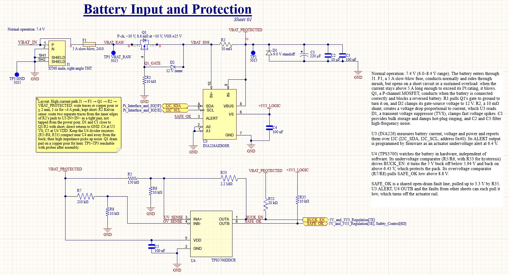
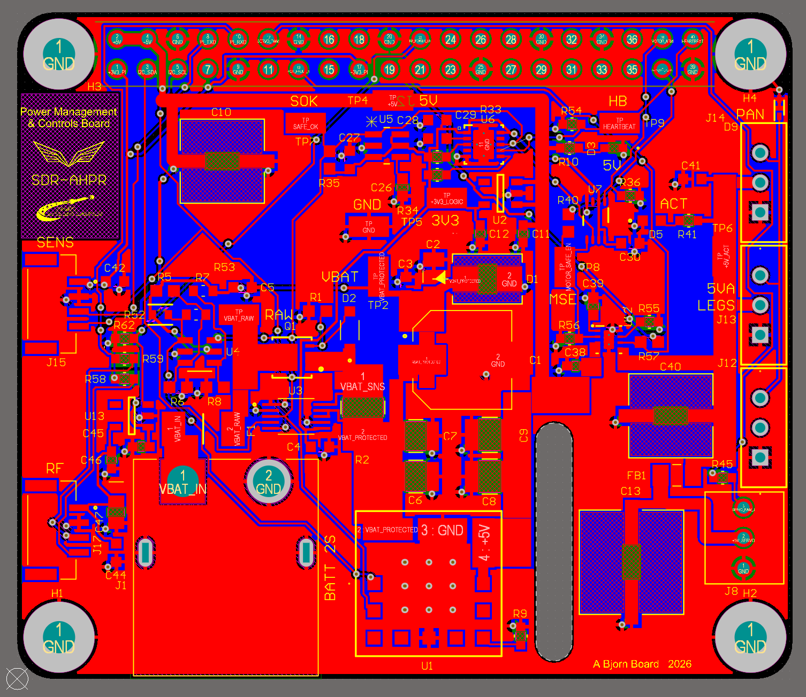
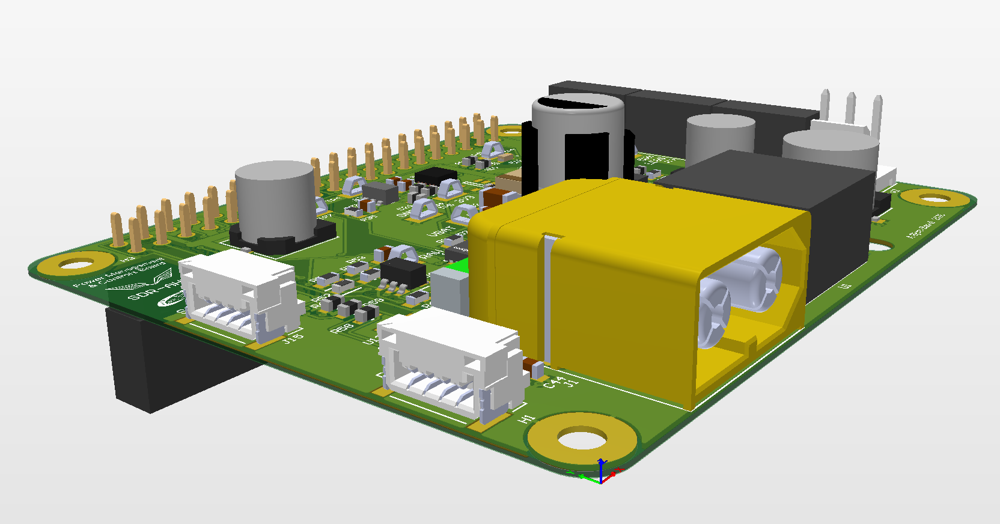
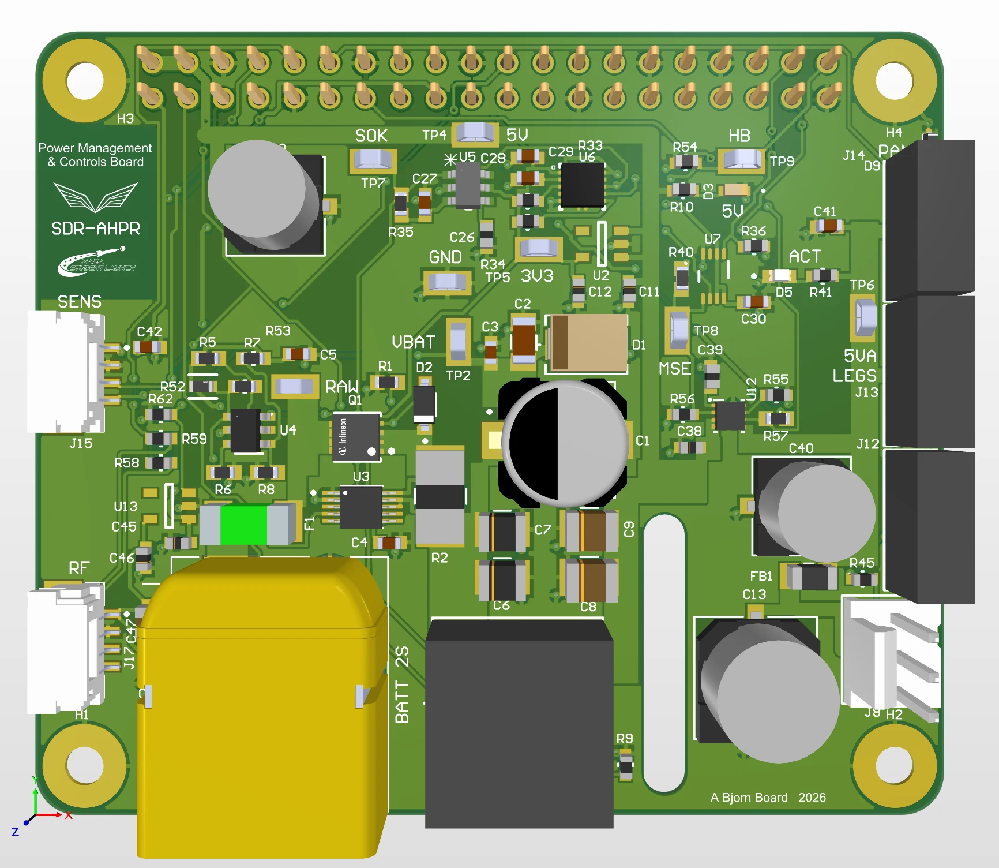
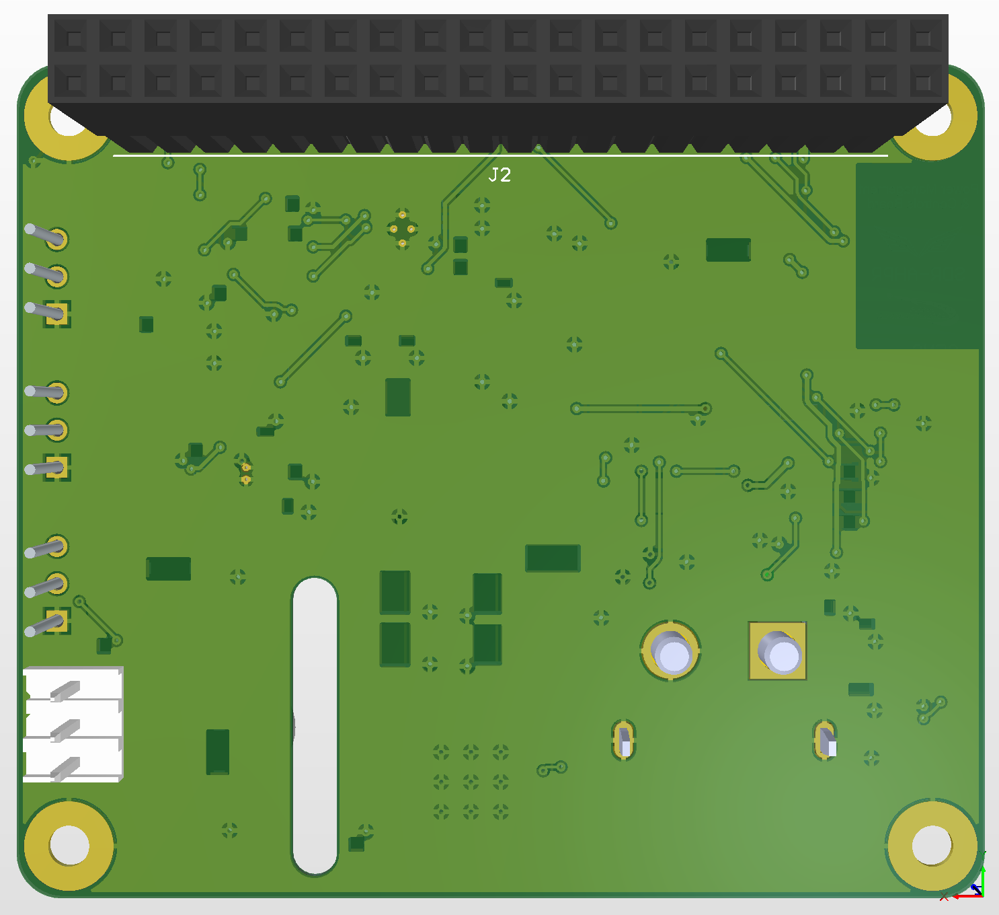
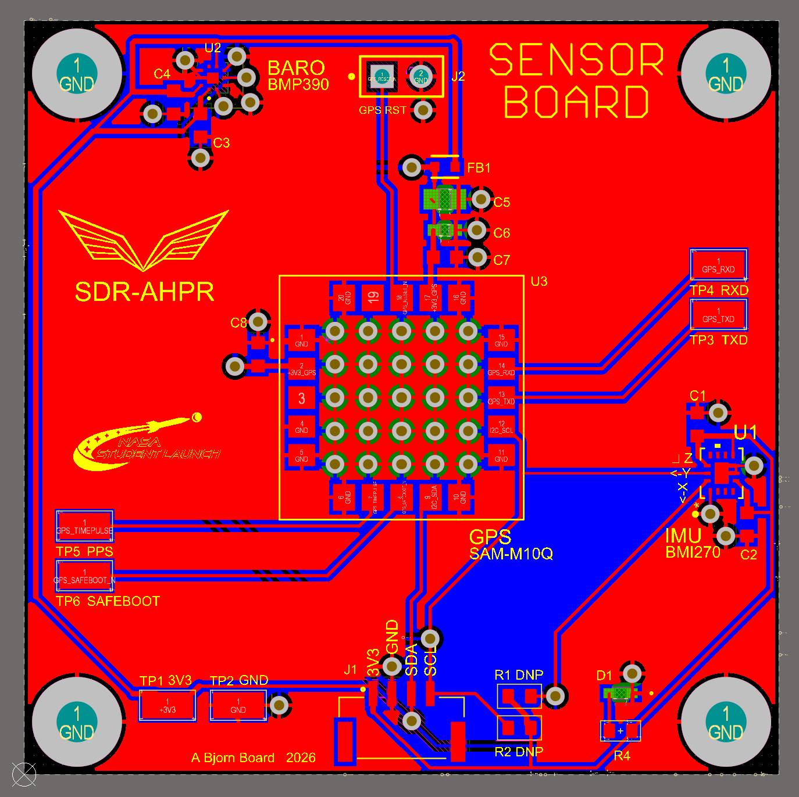
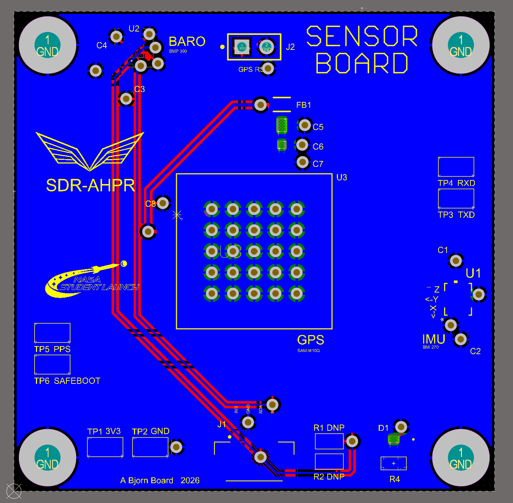
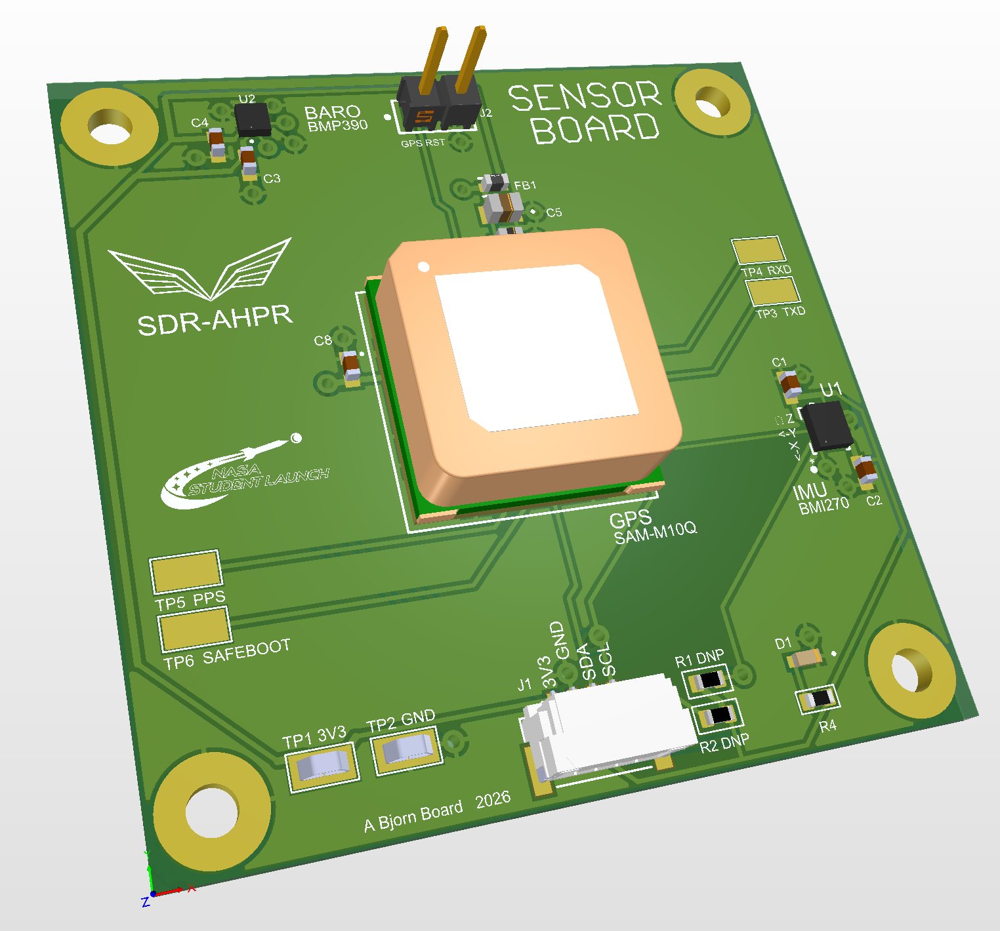
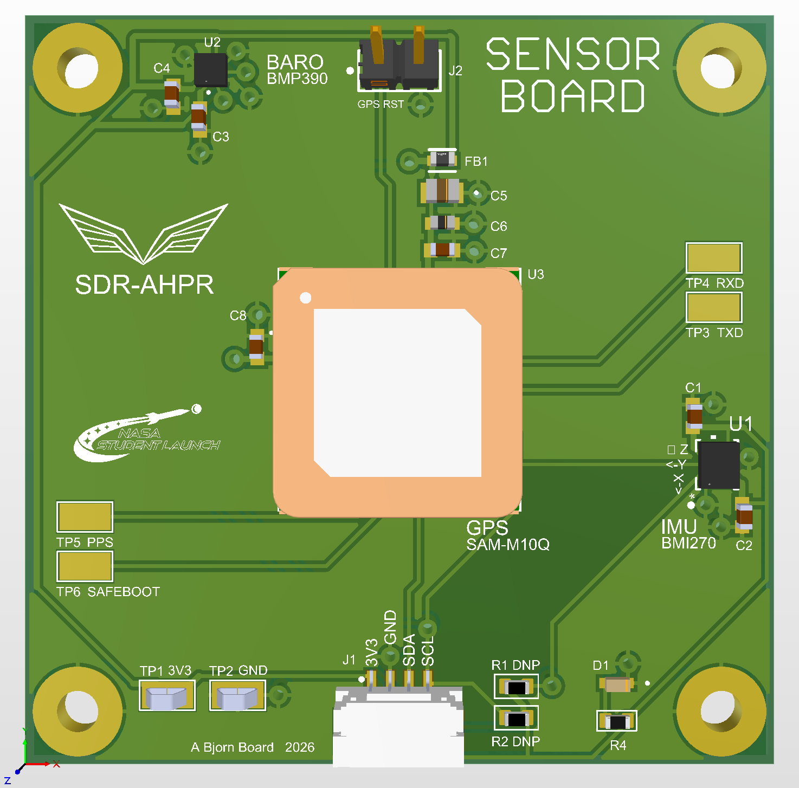
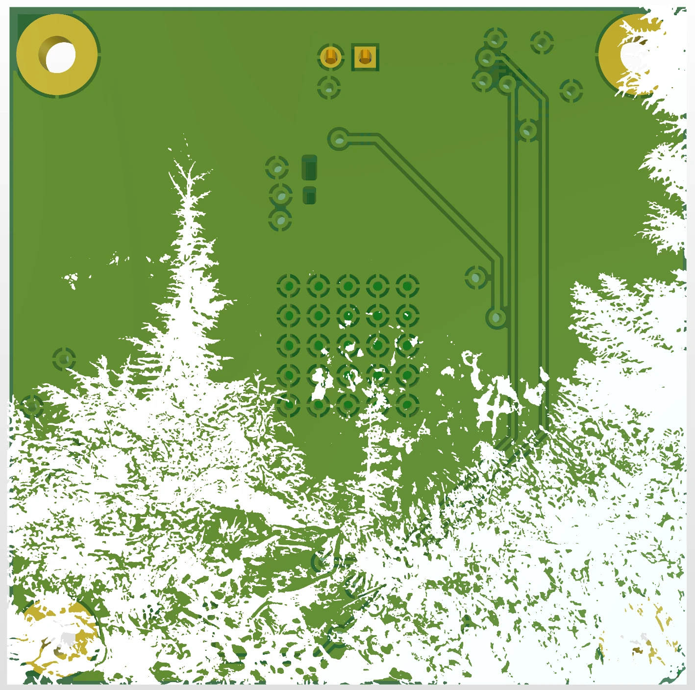

# AHPR Electrical Boards

Altium Designer projects for the two AHPR Lotus electrical boards. Open the `.PrjPcb` inside a board's folder to load that project.

| Board | Size | Folder |
| --- | --- | --- |
| [Power Management and Controls Board](#power-management-and-controls-board-rev-2) | 65 x 56 mm, 2 layers | [`AHPR_Power_Management_and_Controls_Board/`](AHPR_Power_Management_and_Controls_Board) |
| [Sensor Board](#sensor-board-rev-2) | 50 x 50 mm, 2 layers | [`AHPR_Sensor_Board/`](AHPR_Sensor_Board) |

## Power Management and Controls Board (Rev 2)

Raspberry Pi 3 A+ HAT that takes the battery input and protects it, regulates 5 V and 3.3 V, powers the actuators, drives the Dynamixel bus and handles safety control. It supplies 3.3 V and the I2C bus to the sensor board through J15.

### Schematic

### 2D layout

Top layer, with the component pads, power pours and signal routing.

Bottom layer, showing the ground pour, stitching vias and the bottom-side signal routes.

### 3D model

### Dimensions

Full 3D model: [`AHPR_Power_Management_and_Controls_Board.step`](AHPR_Power_Management_and_Controls_Board/AHPR_Power_Management_and_Controls_Board.step) (board with all component models, exported from Altium).

| Side | Dimensions |
| --- | --- |
| Outline | 65 x 56 mm, 3 mm corner radius (Raspberry Pi HAT size) |
| Board thickness | 1.6 mm, 2 copper layers |
| Mounting holes | 4 x M2.5 (H1-H4), centres 3.5 mm in from each edge, 58 x 49 mm apart to match the Pi |
| Top side | All components except J2. Tallest parts are the XT60 battery connector (J1), the buck module (U1) and the electrolytic capacitors |
| Bottom side | J2, the 2x20 female socket that plugs onto the Pi header |
| Top edge | J2 Pi header row, spanning between H3 and H4 |
| Left edge | J15 (SENS, sensor board) and J17 (RF, rangefinder) 4-pin JST GH connectors, opening outward |
| Bottom edge | J1 XT60 battery input (BATT 2S) and U1 buck module, both sitting at the edge |
| Right edge | J14 (PAN), J13 (LEGS) and J12 (Dynamixel in) 3-pin JST EH headers, and J8 servo header near H2 |
| Board cut-out | 20 x 3 mm slot centred at (45, 11.5) mm for the Pi camera ribbon |

### Files

| File | Contents |
| --- | --- |
| [`AHPR_Power_Management_and_Controls_Board.PrjPcb`](AHPR_Power_Management_and_Controls_Board/AHPR_Power_Management_and_Controls_Board.PrjPcb) | Altium project |
| [`AHPR_Power_Management_and_Controls_Board.PcbDoc`](AHPR_Power_Management_and_Controls_Board/AHPR_Power_Management_and_Controls_Board.PcbDoc) | Routed board |
| [`AHPR_Power_Management_and_Controls_Board.step`](AHPR_Power_Management_and_Controls_Board/AHPR_Power_Management_and_Controls_Board.step) | 3D model of the assembled board |
| [`AHPR_Power_Management_and_Controls_Board_Unrouted.PcbDoc`](AHPR_Power_Management_and_Controls_Board/AHPR_Power_Management_and_Controls_Board_Unrouted.PcbDoc) | Same placement and pours with tracks and vias removed |
| [`Battery_Input_and_Protection.SchDoc`](AHPR_Power_Management_and_Controls_Board/Battery_Input_and_Protection.SchDoc) | Schematic sheet 1 |
| [`5V_and_3V3_Regulation.SchDoc`](AHPR_Power_Management_and_Controls_Board/5V_and_3V3_Regulation.SchDoc) | Schematic sheet 2 |
| [`Actuator_Power_and_Dynamixel_Bus.SchDoc`](AHPR_Power_Management_and_Controls_Board/Actuator_Power_and_Dynamixel_Bus.SchDoc) | Schematic sheet 3 |
| [`Safety_Control.SchDoc`](AHPR_Power_Management_and_Controls_Board/Safety_Control.SchDoc) | Schematic sheet 4 |
| [`Pi_Interface_and_IO.SchDoc`](AHPR_Power_Management_and_Controls_Board/Pi_Interface_and_IO.SchDoc) | Schematic sheet 5 |
| [BOM and board definition (PDF)](AHPR_Power_Management_and_Controls_Board/AHPR%20Lotus%20Power%20Management%20PCB%20-%20Rev%202%20BOM%20%26%20Board%20Definition.pdf) | Parts list and board definition |
| [Connector and GPIO map (PDF)](AHPR_Power_Management_and_Controls_Board/AHPR%20Connector%20%26%20GPIO%20Map.pdf) | Connector pinouts and Pi GPIO assignments |
| [`Libraries/`](AHPR_Power_Management_and_Controls_Board/Libraries) | Schematic symbols, footprints and 3D models |
| [Board README](AHPR_Power_Management_and_Controls_Board/README.md) | Board summary, mounting holes and layout notes |

## Sensor Board (Rev 2)

Carries the flight sensors on one I2C bus: a Bosch BMI270 IMU, a Bosch BMP390 barometer and a u-blox SAM-M10Q GPS receiver with its patch antenna at the centre of the board. A 4-pin JST GH connector (J1) brings in 3.3 V, ground, SDA and SCL from power board J15.

**Bill of materials:** [BOM](AHPR_Sensor_Board/BOM.md) ([CSV for ordering](AHPR_Sensor_Board/BOM.csv))

### Schematic

### 2D layout

Top layer, with the component pads, signal and power routing and the top ground pour.

Bottom layer, showing the ground pour, ground vias and the bottom-side I2C and GPS supply routes.

### 3D model

### Dimensions

Full 3D model: [`AHPR_Sensor_Board.step`](AHPR_Sensor_Board/AHPR_Sensor_Board.step) (board with all component models, exported from Altium).

| Side | Dimensions |
| --- | --- |
| Outline | 50 x 50 mm, square corners |
| Board thickness | 1.6 mm, 2 copper layers |
| Mounting holes | 4 x M2.5 (2.75 mm hole, 6 mm plated pad), centres 3.5 mm in from each edge, 43 x 43 mm apart |
| Top side | All components. GPS module (U3) 15.5 x 15.5 mm at the board centre, 6.8 mm tall. J1 connector 4.25 mm tall. J2 header pins are the tallest point at about 8.4 mm. Everything else is under 1.6 mm |
| Bottom side | No components. J2 pin tails stick out about 0.9 mm |
| Bottom edge (J1) | J1 opens toward this edge, housing 0.55 mm inside it. Leave room beyond the edge for the cable plug |
| Top edge | J2 reset header, centred 3.7 mm in from the edge |
| Left and right edges | Test pads only, nothing overhangs |

### Files

| File | Contents |
| --- | --- |
| [`AHPR_Sensor_Board.PrjPcb`](AHPR_Sensor_Board/AHPR_Sensor_Board.PrjPcb) | Altium project |
| [`AHPR_Sensor_Board.SchDoc`](AHPR_Sensor_Board/AHPR_Sensor_Board.SchDoc) | Schematic (one sheet) |
| [`AHPR_Sensor_Board.PcbDoc`](AHPR_Sensor_Board/AHPR_Sensor_Board.PcbDoc) | Routed board: placement, routing, ground pours, silkscreen |
| [`AHPR_Sensor_Board.step`](AHPR_Sensor_Board/AHPR_Sensor_Board.step) | 3D model of the assembled board |
| [`BOM.md`](AHPR_Sensor_Board/BOM.md) | Bill of materials with part links and assembly notes |
| [`BOM.csv`](AHPR_Sensor_Board/BOM.csv) | Bill of materials as a spreadsheet for ordering |
| [`Libraries/`](AHPR_Sensor_Board/Libraries) | Schematic symbols, footprints and 3D models |
| [`Backup_35x40_edge_GPS/`](AHPR_Sensor_Board/Backup_35x40_edge_GPS) | Earlier 35 x 40 mm layout with the GPS at the board edge |

## Adding the images

The pictures above are loaded from the [`images/`](images) folder. Save each export under the file name below and it appears in this README with no further edits.

| File name | Shows |
| --- | --- |
| `images/power_board_schematic_1.jpg` to `_5.jpg` | Power board schematic sheets 1 to 5 |
| `images/power_board_2d_top.png` | Power board 2D layout, top layer |
| `images/power_board_2d.png` | Power board 2D layout, bottom layer |
| `images/power_board_3d.png` | Power board 3D model |
| `images/power_board_3d_left.png` | Power board 3D model, sensor and rangefinder connector side |
| `images/power_board_3d_side.png` | Power board 3D model, connector side |
| `images/power_board_3d_top.png` | Power board 3D model, top view |
| `images/power_board_3d_bottom.png` | Power board 3D model, bottom view |
| `images/sensor_board_schematic.png` | Sensor board schematic |
| `images/sensor_board_2d_top.png` | Sensor board 2D layout, top layer |
| `images/sensor_board_2d.png` | Sensor board 2D layout, bottom layer |
| `images/sensor_board_3d.png` | Sensor board 3D model |
| `images/sensor_board_3d_top.png` | Sensor board 3D model, top view |
| `images/sensor_board_3d_bottom.png` | Sensor board 3D model, bottom view |

Altium's `History`, `__Previews`, `Project Logs` and `Project Outputs` folders are not tracked.
