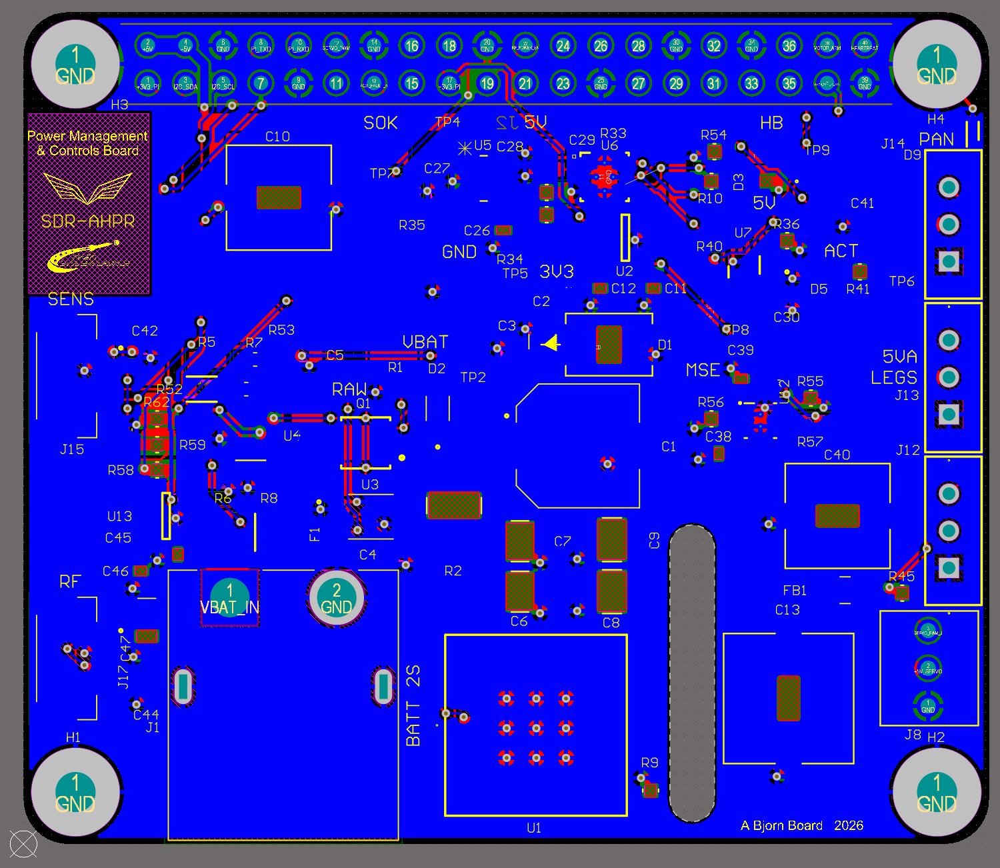
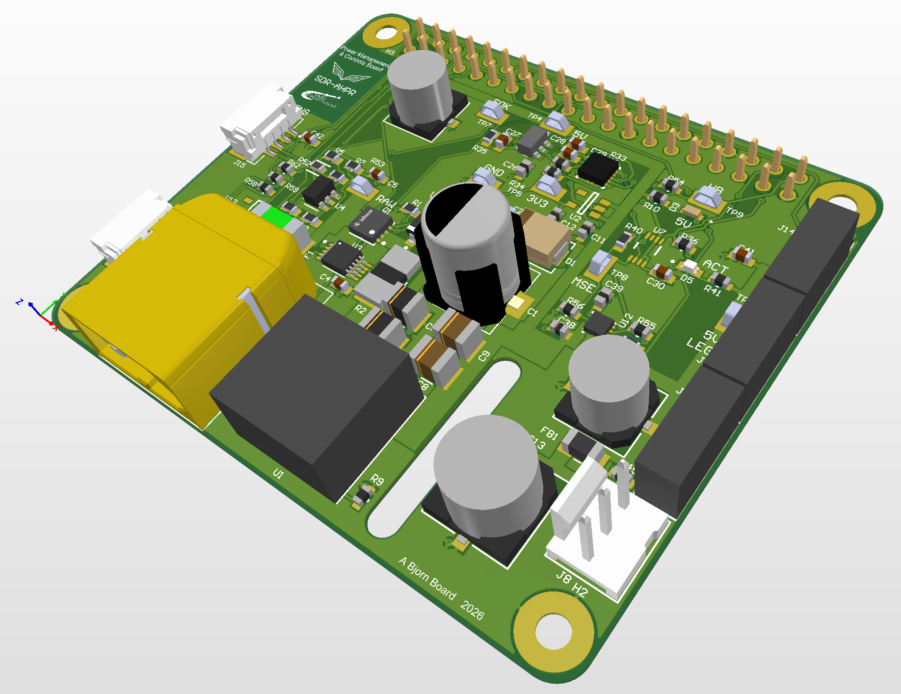
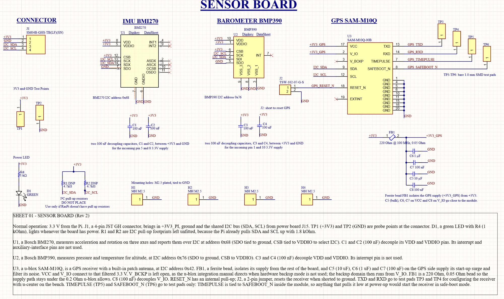

# AHPR Electrical Boards

Altium Designer projects for the two AHPR Lotus electrical boards. Open the `.PrjPcb` inside a board's folder to load that project.

| Board | Size | Folder |
| --- | --- | --- |
| [Power Management and Controls Board](#power-management-and-controls-board-rev-2) | 65 x 56 mm, 2 layers | [`AHPR_Power_Management_and_Controls_Board/`](AHPR_Power_Management_and_Controls_Board) |
| [Sensor Board](#sensor-board-rev-2) | 50 x 50 mm, 2 layers | [`AHPR_Sensor_Board/`](AHPR_Sensor_Board) |

## Power Management and Controls Board (Rev 2)

Raspberry Pi 3 A+ HAT that takes the battery input and protects it, regulates 5 V and 3.3 V, powers the actuators, drives the Dynamixel bus and handles safety control. It supplies 3.3 V and the I2C bus to the sensor board through J15.

### Schematic

Individual sheets:
[1 Battery Input and Protection](AHPR_Power_Management_and_Controls_Board/%28Sheet%2001%29%20Battery%20Input%20and%20Protection.jpg) ·
[2 5 V and 3.3 V Regulation](AHPR_Power_Management_and_Controls_Board/%28Sheet%2002%29%205%20V%20and%203.3%20V%20Regulation.jpg) ·
[3 Actuator Power and Dynamixel Bus](AHPR_Power_Management_and_Controls_Board/%28Sheet%2003%29%20Actuator%20Power%20and%20Dynamixel%20Bus.jpg) ·
[4 Safety Control](AHPR_Power_Management_and_Controls_Board/%28Sheet%2004%29%20Safety%20Control.jpg) ·
[5 Pi Interface and IO](AHPR_Power_Management_and_Controls_Board/%28Sheet%2005%29%20Pi%20Interface%20and%20IO.jpg)

### 2D layout

### 3D model

### Files

| File | Contents |
| --- | --- |
| [`AHPR_Power_Management_and_Controls_Board.PrjPcb`](AHPR_Power_Management_and_Controls_Board/AHPR_Power_Management_and_Controls_Board.PrjPcb) | Altium project |
| [`AHPR_Power_Management_and_Controls_Board.PcbDoc`](AHPR_Power_Management_and_Controls_Board/AHPR_Power_Management_and_Controls_Board.PcbDoc) | Routed board |
| [`AHPR_Power_Management_and_Controls_Board_Unrouted.PcbDoc`](AHPR_Power_Management_and_Controls_Board/AHPR_Power_Management_and_Controls_Board_Unrouted.PcbDoc) | Same placement and pours with tracks and vias removed |
| [`Battery_Input_and_Protection.SchDoc`](AHPR_Power_Management_and_Controls_Board/Battery_Input_and_Protection.SchDoc) | Schematic sheet 1 |
| [`5V_and_3V3_Regulation.SchDoc`](AHPR_Power_Management_and_Controls_Board/5V_and_3V3_Regulation.SchDoc) | Schematic sheet 2 |
| [`Actuator_Power_and_Dynamixel_Bus.SchDoc`](AHPR_Power_Management_and_Controls_Board/Actuator_Power_and_Dynamixel_Bus.SchDoc) | Schematic sheet 3 |
| [`Safety_Control.SchDoc`](AHPR_Power_Management_and_Controls_Board/Safety_Control.SchDoc) | Schematic sheet 4 |
| [`Pi_Interface_and_IO.SchDoc`](AHPR_Power_Management_and_Controls_Board/Pi_Interface_and_IO.SchDoc) | Schematic sheet 5 |
| [BOM and board definition (PDF)](AHPR_Power_Management_and_Controls_Board/AHPR%20Lotus%20Power%20Management%20PCB%20-%20Rev%202%20BOM%20%26%20Board%20Definition.pdf) | Parts list and board definition |
| [Connector and GPIO map (PDF)](AHPR_Power_Management_and_Controls_Board/AHPR%20Connector%20%26%20GPIO%20Map.pdf) | Connector pinouts and Pi GPIO assignments |
| [`Libraries/`](AHPR_Power_Management_and_Controls_Board/Libraries) | Schematic symbols, footprints and 3D models |
| [Board README](AHPR_Power_Management_and_Controls_Board/README.md) | Board summary, mounting holes and layout notes |

## Sensor Board (Rev 2)

Carries the flight sensors on one I2C bus: a Bosch BMI270 IMU, a Bosch BMP390 barometer and a u-blox SAM-M10Q GPS receiver with its patch antenna at the centre of the board. A 4-pin JST GH connector (J1) brings in 3.3 V, ground, SDA and SCL from power board J15.

### Schematic

### 2D layout

### 3D model

### Files

| File | Contents |
| --- | --- |
| [`AHPR_Sensor_Board.PrjPcb`](AHPR_Sensor_Board/AHPR_Sensor_Board.PrjPcb) | Altium project |
| [`AHPR_Sensor_Board.SchDoc`](AHPR_Sensor_Board/AHPR_Sensor_Board.SchDoc) | Schematic (one sheet) |
| [`AHPR_Sensor_Board.PcbDoc`](AHPR_Sensor_Board/AHPR_Sensor_Board.PcbDoc) | Board: placement and ground pours, not yet routed |
| [`Libraries/`](AHPR_Sensor_Board/Libraries) | Schematic symbols, footprints and 3D models |
| [`Backup_35x40_edge_GPS/`](AHPR_Sensor_Board/Backup_35x40_edge_GPS) | Earlier 35 x 40 mm layout with the GPS at the board edge |

## Adding the images

The pictures above are loaded from the [`images/`](images) folder. Save each export under the file name below and it appears in this README with no further edits.

| File name | Shows |
| --- | --- |
| `images/power_board_schematic.png` | Power board schematic |
| `images/power_board_2d.png` | Power board 2D layout |
| `images/power_board_3d.png` | Power board 3D model |
| `images/sensor_board_schematic.png` | Sensor board schematic |
| `images/sensor_board_2d.png` | Sensor board 2D layout |
| `images/sensor_board_3d.png` | Sensor board 3D model |

Altium's `History`, `__Previews`, `Project Logs` and `Project Outputs` folders are not tracked.
