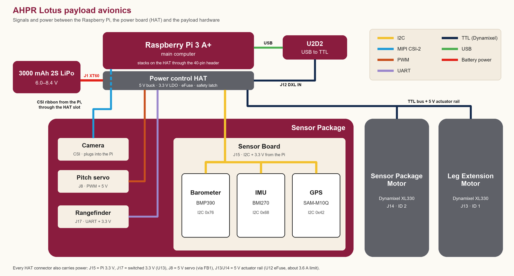
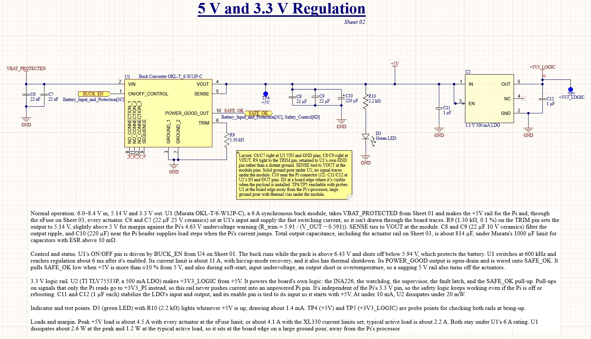
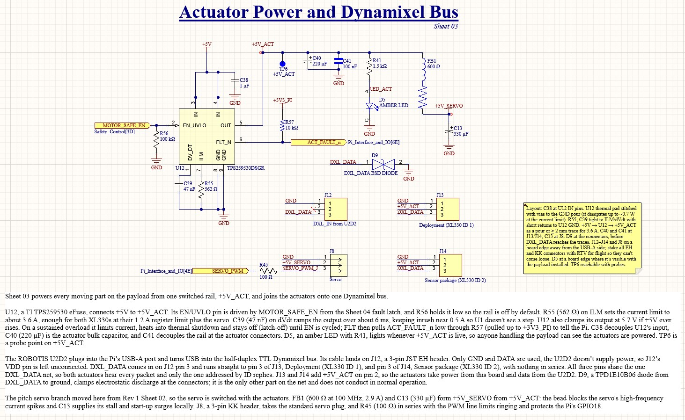
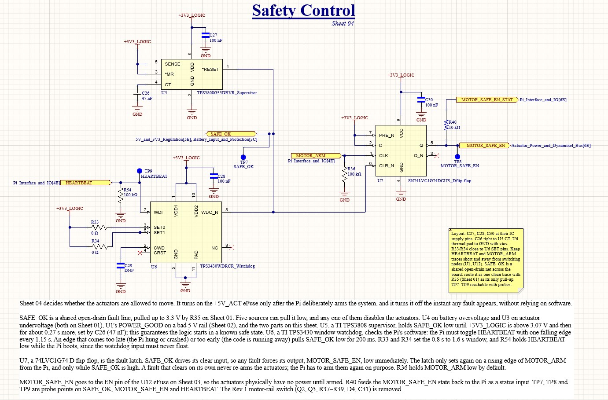
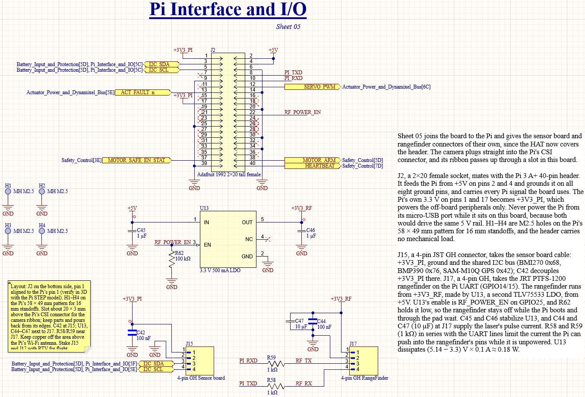
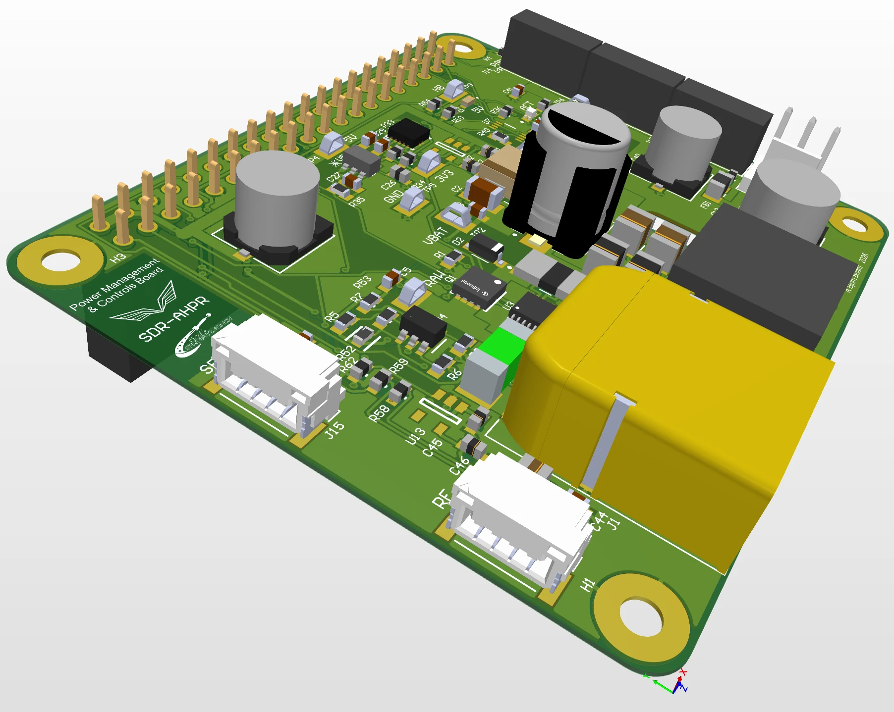
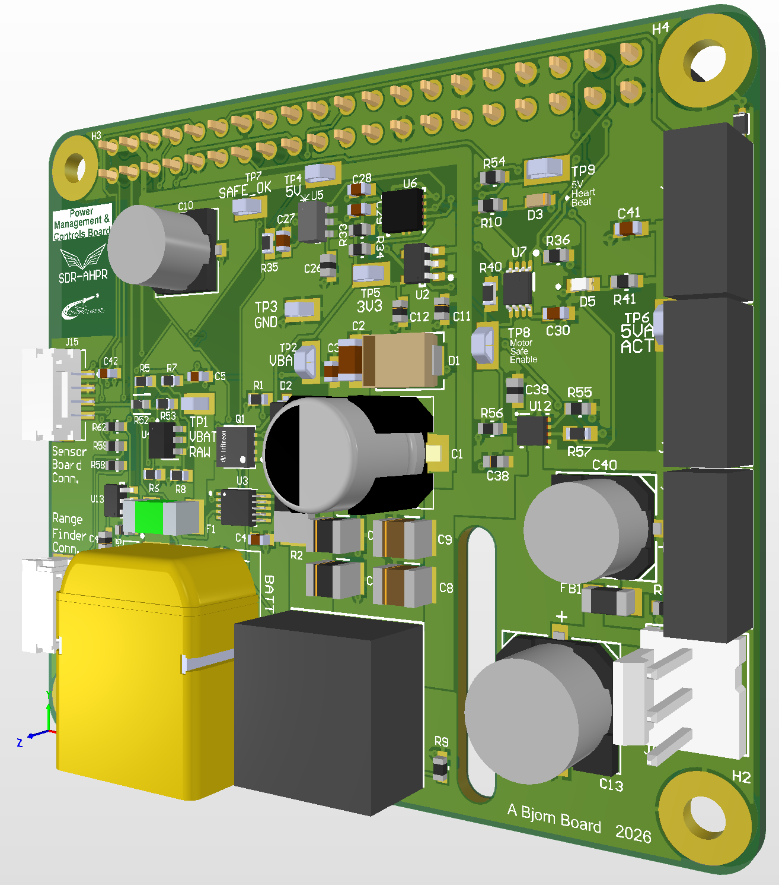

# AHPR Electrical Boards for NASA Launch Competition. Designed by Bjorn Bengtsson.

Altium Designer projects for the two AHPR Lotus electrical boards. Open the `.PrjPcb` inside a board's folder to load that project.

| Board | Size | Folder |
| --- | --- | --- |
| [Power Management and Controls Board](#power-management-and-controls-board-rev-2) | 65 x 56 mm, 2 layers | [`AHPR_Power_Management_and_Controls_Board/`](AHPR_Power_Management_and_Controls_Board) |
| [Sensor Board](#sensor-board-rev-2) | 50 x 50 mm, 2 layers | [`AHPR_Sensor_Board/`](AHPR_Sensor_Board) |

## Mission

The boards fly in **Lotus**, the payload for Team Leviathan's entry in the 2027 NASA Student Launch (Advanced High Powered Rocketry team, Sun Devil Rocketry Club, Arizona State University). Lotus rides in a 3D-printed coupler between the upper and lower body tubes of a 64 in long, 4.1 in diameter fiberglass rocket (AeroTech K535W, about 4,790 ft predicted apogee). Fiberglass was chosen partly because it is RF-transparent, so the GPS can see the sky. The recovery avionics (Blue Jay primary, EasyMini backup) are a separate system; nothing on these boards fires a recovery charge.

### Payload objectives

| # | Objective | What the electronics do |
| --- | --- | --- |
| 01 | Upright: self-right after landing | Pi drives the leg-extension motor (XL330 on J13) |
| 02 | Locate: find the NASA target | Camera image processing while the sensor-package motor (XL330 on J14) pans the head |
| 03 | Image: clear, time-stamped capture | Pi camera on the CSI connector; pitch servo on J8 aims it |
| 04 | Distance: computed without GPS | Laser rangefinder on J17 (UART) |
| 05 | Log: keep the result and metadata | Image saved on the Pi with range and GPS position (SAM-M10Q) encoded |
| 06 | Time: finish within 15 minutes of landing | Battery sized for a 3 h pad wait plus 15 min of active operation (R-8) |

### Concept of operations

1. **Pad wait and flight.** After power-up the Pi watches the accelerometer (BMI270) and barometer (BMP390) to detect launch.
2. **Touchdown.** Landing is detected as constant altitude with no rotation.
3. **Self-right.** The leg motor turns until enough steps are counted; the four legs extend and stand the payload up.
4. **Extend the sensor package.** The sensor-package motor raises the head until it is fully extended and free to rotate.
5. **Scan.** The head pans ±180° (so the cables do not wind up) while the camera looks for target candidates.
6. **Pick the target.** The candidate with the highest target pixel count that is within rangefinder range is chosen.
7. **Save.** A final picture is taken and ranged, and the image is saved with the range and GPS data encoded.

## System Overview

The Raspberry Pi 3 A+ is the only controller. The power board sits on it as a HAT, takes the 2S LiPo, and feeds the sensor board (barometer, IMU, GPS over I2C), the pitch servo (PWM), the rangefinder (UART) and the two Dynamixel XL330 motors (TTL bus from the U2D2, with motor power from the board). The camera plugs straight into the Pi's CSI connector; its ribbon passes through a slot in the power board.

## Design Constraints

Fixed limits the design had to work within.

| ID | Constraint | Source | Design impact |
| --- | --- | --- | --- |
| C-1 | Rocket diameter: 4.1 in (104 mm); the payload rides inside the coupler between the body tubes | Rocket airframe (PDR) | Boards had to be kept small to fit inside the coupler alongside the leg and sensor-package mechanisms |
| C-2 | Low budget: about $400 for the payload avionics | Team funding | Boards had to be easy and cheap to manufacture: 2 layers, standard JLCPCB specs, common stocked parts, hand assembly in the club lab |
| C-3 | Controller is a Raspberry Pi 3 A+ | Team decision | Power board is a 65 x 56 mm HAT on M2.5 x 16 mm standoffs |
| C-4 | Power from one 2S 3000 mAh LiPo with an XT60 connector | Team decision | All rails derived from 6.0–8.4 V input |
| C-5 | Boards must be assembled by hand in the club lab (no reflow oven or pick-and-place) | Team resources | 0603 minimum passives, leaded ICs where available, stencil + hotplate only for LGA/WSON/VSON parts |
| C-6 | 2-layer FR-4, 1.6 mm | Fab cost | Ground pours on both layers, stitching vias |
| C-7 | Launch day: Saturday, April 10, 2027, Huntsville, AL. April normals 11–24 °C, records −4 to 35 °C; payload bay operating range 0–50 °C | NASA SL; NWS Huntsville normals and extremes | Battery reserve checked down to the −4 °C record low; pack kept warm and foam-wrapped until launch |

## Requirements

What the electrical system shall do.

| ID | Requirement | Implemented by |
| --- | --- | --- |
| R-1 | The power board shall supply regulated 5 V to the Pi above its 4.63 V undervoltage warning under full actuator load | U1 buck, trimmed above 5 V |
| R-2 | The power board shall supply 3.3 V and I2C to the sensor board | Pi 3.3 V rail (+3V3_PI) and the Pi I2C bus, through J15 |
| R-3 | The power board shall power two XL330 actuators and one PWM servo from a switched, current-limited rail (about 3.6 A) | U12 eFuse, +5V_ACT |
| R-4 | The system shall de-energize all actuators if the Pi stops responding | U6 window watchdog, U7 fault latch |
| R-5 | The system shall disable actuators on battery overvoltage (about 8.8 V) or undervoltage (about 6.4 V), and shut the 5 V rail off before the pack is over-discharged | U4 comparator (overvoltage trips SAFE_OK; buck off below 5.94 V, back on above 6.43 V), U3 INA226 alert at 6.4 V |
| R-6 | The system shall report battery voltage, current and power to the Pi | U3 INA226 at 0x40 |
| R-7 | The sensor board shall measure attitude rates, acceleration, pressure altitude and GNSS position over one I2C bus | BMI270 (0x68), BMP390 (0x76), SAM-M10Q (0x42) |
| R-8 | The battery shall power the full mission (about 1.07 Ah: 3 h pad wait plus 15 min active) with margin | 2S 3000 mAh pack: 2.40 Ah usable at 80 % depth of discharge, about 55 % reserve at 25 °C, 49 % at 11 °C and 38 % at the −4 °C record low |
| R-9 | Reverse polarity, short circuits and transients on the battery input shall not damage the boards | Q1 P-FET (reverse polarity), F1 5 A fuse, D1 TVS |
| R-10 | The system shall detect launch and landing on its own | BMI270 accelerometer and BMP390 barometer on the sensor board |
| R-11 | The system shall save a time-stamped image of the target with its range and GPS position | Pi camera (CSI), rangefinder on J17, SAM-M10Q GPS, Pi storage |

## Power Management and Controls Board (Rev 2)

Raspberry Pi 3 A+ HAT that takes the battery input and protects it, regulates 5 V and 3.3 V, powers the actuators, drives the Dynamixel bus and handles safety control. It supplies 3.3 V and the I2C bus to the sensor board through J15.

### Schematic

### 2D layout

Top layer, with the component pads, power pours, signal routing and polarity marks.

Bottom layer, showing the ground pour, stitching vias, bottom-side signal routes and the connector pin labels.

### 3D model

### Dimensions

Full 3D model: [`AHPR_Power_Management_and_Controls_Board.step`](AHPR_Power_Management_and_Controls_Board/AHPR_Power_Management_and_Controls_Board.step) (board with all component models, exported from Altium).

| Side | Dimensions |
| --- | --- |
| Outline | 65 x 56 mm, 3 mm corner radius (Raspberry Pi HAT size) |
| Board thickness | 1.6 mm, 2 copper layers |
| Mounting holes | 4 x M2.5 (H1-H4), centres 3.5 mm in from each edge, 58 x 49 mm apart to match the Pi |
| Top side | All components except J2. Tallest parts are the XT60 battery connector (J1), the buck module (U1) and the electrolytic capacitors |
| Bottom side | J2, the 2x20 female socket that plugs onto the Pi header |
| Top edge | J2 Pi header row, spanning between H3 and H4 |
| Left edge | J15 (SENS, sensor board) and J17 (RF, rangefinder) 4-pin JST GH connectors, opening outward |
| Bottom edge | J1 XT60 battery input (BATT 2S) and U1 buck module, both sitting at the edge |
| Right edge | J14 (SENSOR, sensor-package motor), J13 (DEPLOY, leg motor) and J12 (DXL IN, from the U2D2) 3-pin JST EH headers, and J8 servo header near H2 |
| Board cut-out | 20 x 3 mm slot centred at (45, 11.5) mm for the Pi camera ribbon |

### Files

| File | Contents |
| --- | --- |
| [`AHPR_Power_Management_and_Controls_Board.PrjPcb`](AHPR_Power_Management_and_Controls_Board/AHPR_Power_Management_and_Controls_Board.PrjPcb) | Altium project |
| [`AHPR_Power_Management_and_Controls_Board.PcbDoc`](AHPR_Power_Management_and_Controls_Board/AHPR_Power_Management_and_Controls_Board.PcbDoc) | Routed board |
| [`AHPR_Power_Management_and_Controls_Board.step`](AHPR_Power_Management_and_Controls_Board/AHPR_Power_Management_and_Controls_Board.step) | 3D model of the assembled board |
| [`AHPR_Power_Management_and_Controls_Board_Unrouted.PcbDoc`](AHPR_Power_Management_and_Controls_Board/AHPR_Power_Management_and_Controls_Board_Unrouted.PcbDoc) | Same placement and pours with tracks and vias removed |
| [`Battery_Input_and_Protection.SchDoc`](AHPR_Power_Management_and_Controls_Board/Battery_Input_and_Protection.SchDoc) | Schematic sheet 1 |
| [`5V_and_3V3_Regulation.SchDoc`](AHPR_Power_Management_and_Controls_Board/5V_and_3V3_Regulation.SchDoc) | Schematic sheet 2 |
| [`Actuator_Power_and_Dynamixel_Bus.SchDoc`](AHPR_Power_Management_and_Controls_Board/Actuator_Power_and_Dynamixel_Bus.SchDoc) | Schematic sheet 3 |
| [`Safety_Control.SchDoc`](AHPR_Power_Management_and_Controls_Board/Safety_Control.SchDoc) | Schematic sheet 4 |
| [`Pi_Interface_and_IO.SchDoc`](AHPR_Power_Management_and_Controls_Board/Pi_Interface_and_IO.SchDoc) | Schematic sheet 5 |
| [BOM and board definition (PDF)](AHPR_Power_Management_and_Controls_Board/AHPR%20Lotus%20Power%20Management%20PCB%20-%20Rev%202%20BOM%20%26%20Board%20Definition.pdf) | Parts list and board definition |
| [Connector and GPIO map (PDF)](AHPR_Power_Management_and_Controls_Board/AHPR%20Connector%20%26%20GPIO%20Map.pdf) | Connector pinouts and Pi GPIO assignments |
| [`Libraries/`](AHPR_Power_Management_and_Controls_Board/Libraries) | Schematic symbols, footprints and 3D models |
| [Board README](AHPR_Power_Management_and_Controls_Board/README.md) | Board summary, mounting holes and layout notes |

## Sensor Board (Rev 2)

Carries the flight sensors on one I2C bus: a Bosch BMI270 IMU, a Bosch BMP390 barometer and a u-blox SAM-M10Q GPS receiver with its patch antenna at the centre of the board. A 4-pin JST GH connector (J1) brings in 3.3 V, ground, SDA and SCL from power board J15.

**Bill of materials:** [BOM](AHPR_Sensor_Board/BOM.md) ([CSV for ordering](AHPR_Sensor_Board/BOM.csv))

### Schematic

### 2D layout

Top layer, with the component pads, signal and power routing and the top ground pour.

Bottom layer, showing the ground pour, tented ground vias and the bottom-side I2C and GPS supply routes.

### 3D model

### Dimensions

Full 3D model: [`AHPR_Sensor_Board.step`](AHPR_Sensor_Board/AHPR_Sensor_Board.step) (board with all component models, exported from Altium).

| Side | Dimensions |
| --- | --- |
| Outline | 50 x 50 mm, square corners |
| Board thickness | 1.6 mm, 2 copper layers |
| Mounting holes | 4 x M2.5 (2.75 mm hole, 6 mm plated pad), centres 3.5 mm in from each edge, 43 x 43 mm apart |
| Top side | All components. GPS module (U3) 15.5 x 15.5 mm at the board centre, 6.8 mm tall. J1 connector 4.25 mm tall. J2 header pins are the tallest point at about 8.4 mm. Everything else is under 1.6 mm |
| Bottom side | No components. Pen-and-ink painting on the bottom silkscreen. J2 pin tails stick out about 0.9 mm |
| Bottom edge (J1) | J1 opens toward this edge, housing 0.55 mm inside it. Leave room beyond the edge for the cable plug |
| Top edge | J2 reset header, centred 3.7 mm in from the edge |
| Left and right edges | Test pads only, nothing overhangs |

### Files

| File | Contents |
| --- | --- |
| [`AHPR_Sensor_Board.PrjPcb`](AHPR_Sensor_Board/AHPR_Sensor_Board.PrjPcb) | Altium project |
| [`AHPR_Sensor_Board.SchDoc`](AHPR_Sensor_Board/AHPR_Sensor_Board.SchDoc) | Schematic (one sheet) |
| [`AHPR_Sensor_Board.PcbDoc`](AHPR_Sensor_Board/AHPR_Sensor_Board.PcbDoc) | Routed board: placement, routing, ground pours, silkscreen |
| [`AHPR_Sensor_Board.step`](AHPR_Sensor_Board/AHPR_Sensor_Board.step) | 3D model of the assembled board |
| [`BOM.md`](AHPR_Sensor_Board/BOM.md) | Bill of materials with part links and assembly notes |
| [`BOM.csv`](AHPR_Sensor_Board/BOM.csv) | Bill of materials as a spreadsheet for ordering |
| [`Libraries/`](AHPR_Sensor_Board/Libraries) | Schematic symbols, footprints and 3D models |
| [`Backup_35x40_edge_GPS/`](AHPR_Sensor_Board/Backup_35x40_edge_GPS) | Earlier 35 x 40 mm layout with the GPS at the board edge |

## Adding the images

The pictures above are loaded from the [`images/`](images) folder. Save each export under the file name below and it appears in this README with no further edits.

| File name | Shows |
| --- | --- |
| `images/system_block_diagram.png` | System block diagram |
| `images/power_board_schematic_1.jpg` to `_5.jpg` | Power board schematic sheets 1 to 5 |
| `images/power_board_2d_top.png` | Power board 2D layout, top layer |
| `images/power_board_2d.png` | Power board 2D layout, bottom layer |
| `images/power_board_3d.png` | Power board 3D model |
| `images/power_board_3d_left.png` | Power board 3D model, sensor and rangefinder connector side |
| `images/power_board_3d_side.png` | Power board 3D model, connector side |
| `images/power_board_3d_right.png` | Power board 3D model, actuator connector side |
| `images/power_board_3d_top.png` | Power board 3D model, top view |
| `images/power_board_3d_bottom.png` | Power board 3D model, bottom view |
| `images/sensor_board_schematic.png` | Sensor board schematic |
| `images/sensor_board_2d_top.png` | Sensor board 2D layout, top layer |
| `images/sensor_board_2d.png` | Sensor board 2D layout, bottom layer |
| `images/sensor_board_3d.png` | Sensor board 3D model |
| `images/sensor_board_3d_top.png` | Sensor board 3D model, top view |
| `images/sensor_board_3d_bottom.png` | Sensor board 3D model, bottom view |

Altium's `History`, `__Previews`, `Project Logs` and `Project Outputs` folders are not tracked.
